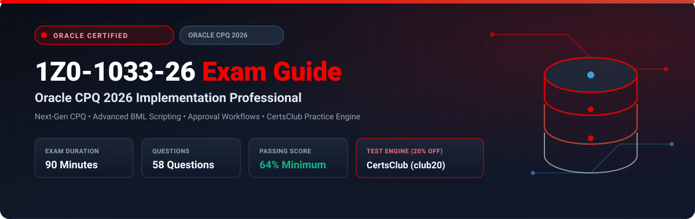

<p align="center">
  
</p>

# Oracle CPQ 2026 Implementation Professional (1Z0-1033-26) Exam Study Guide & Practice Test Resource Portal

[-f80000?style=for-the-badge&logo=oracle&logoColor=white)](https://education.oracle.com/)
[-f80000?style=for-the-badge&logo=oracle)](https://education.oracle.com/)
[](https://education.oracle.com/)
[](https://education.oracle.com/)
[](https://education.oracle.com/)
[-28a745?style=for-the-badge&logo=shield)](https://www.certsclub.com/oracle/)

---

## 1. Exam Overview & Candidate Profile

The **Oracle CPQ 2026 Implementation Professional (1Z0-1033-26)** exam validates that an implementation consultant possesses up-to-date knowledge and practical skills required to design, implement, and maintain enterprise CPQ solutions. This 2026 edition reflects the newest platform features, including enhanced Document Designer capabilities, optimized BML function execution, AI-driven pricing recommendations, and modernized REST API integrations with ERP and CRM platforms.

Passing 1Z0-1033-26 grants the **Oracle CPQ 2026 Certified Implementation Professional** credential.

### Target Candidate Profile & Career Roles
* **Oracle CPQ Architects & Technical Consultants**
* **Quote-to-Cash (Q2C) Enterprise Developers**
* **Lead Pricing System Implementers**
* **Prerequisites:** Thorough hands-on implementation experience in Oracle CPQ Cloud, proficiency in BML and BMQL, and experience building multi-step approval workflows.

---

## 2. Key Exam Specifications

| Parameter | Official Specification |
| :--- | :--- |
| **Exam Code** | 1Z0-1033-26 |
| **Exam Title** | Oracle CPQ 2026 Implementation Professional |
| **Associated Credential** | Oracle CPQ 2026 Certified Implementation Professional |
| **Duration** | 90 Minutes |
| **Number of Questions** | 58 Questions |
| **Passing Score** | 64% |
| **Question Format** | Multiple Choice (Single and Multiple Select) |
| **Delivery Vendor** | Pearson VUE / Oracle University Online Remote Proctoring |
| **Recommended Practice Test Engine** | **[1Z0-1033-26 Practice Test - CertsClub](https://www.certsclub.com/oracle/)** (Coupon: `club20` for 20% off) |

---

## 3. Official Blueprint & Exam Domain Breakdown

| Domain Code | Domain Title | Weighting | Key Competencies Covered |
| :--- | :--- | :---: | :--- |
| **1.0** | **Product Configuration Architecture** | **24%** | Product families, product lines, and models; Multi-tier attribute arrays; Advanced constraint rules, recommendation item rules, and hiding rules; Configuration BOM mapping. |
| **2.0** | **Commerce Processes & Transaction Workflows** | **24%** | Designing Commerce steps, actions, and formulas; Multi-level approval hierarchies; Parallel vs sequential approvals; Managing transaction lifecycle states. |
| **3.0** | **Document Engine & Proposal Automation** | **20%** | Modern Document Designer layouts; Dynamic headers, repeating table sections, conditional logic; PDF and DOCX generation; Electronic signature workflows. |
| **4.0** | **Advanced BML Scripting & Performance** | **18%** | BML script library architecture; Optimized BMQL queries; JSON manipulation in BML; Error handling and transaction rollback triggers. |
| **5.0** | **Integration, Migration & Environment Management** | **14%** | REST APIs and Web Services; Migration Center deployments across DEV/TEST/PROD; Data Table management; Bulk upload automation. |

---

## 4. Deep Dive into Complex Exam Topics

### 4.1 Commerce Action Execution Pipeline
When a user clicks an Action button (e.g., "Submit Order" or "Calculate Pricing") in Commerce:
1. **Validation Rules:** Evaluate first. If any rule fails, execution halts and errors display to the user.
2. **Formula Calculations:** Attribute default formulas compute.
3. **Advanced BML (Modify Functions):** Custom BML scripts execute to modify attributes or call external web services.
4. **Approval Rules:** Evaluated to determine if the transaction moves to an approval step or proceeds directly to fulfilled status.
5. **Destination Step:** Transaction state updates to the destination step defined on the action.

---

## 5. Scenario-Based Demo Questions & Technical Explanations

### Question 1: Optimizing High-Volume BML Scripts
**Scenario:** A client reports slow performance when clicking "Update Pricing" on quotes with more than 200 line items. Reviewing the BML script reveals a BMQL query inside a `for` loop that iterates over each line item to query discount percentages from a Data Table.

Which architectural refactoring eliminates the performance bottleneck?

A) Convert the BMQL query to an external REST API call.  
B) Move the BMQL query outside the loop, query all relevant discounts in a single statement, store the results in a Dictionary or 2D Array, and perform in-memory lookups within the loop.  
C) Increase the CPQ server timeout parameter.  
D) Convert the line item loop into a while loop.  

**Correct Answer:** **B**

**Detailed Explanation:**
* Executing database queries (`bmql`) inside iterative loops causes the "N+1 query problem", resulting in massive I/O latency on quotes with many line items.
* The established best practice in Oracle CPQ is to execute a single bulk BMQL query before the loop, load records into a memory structure (such as a Dictionary), and perform fast in-memory key-value lookups inside the loop.

---

## 6. Recommended Preparation Strategy & Practice Testing Engine

To pass 1Z0-1033-26 on your first attempt:

1. **Test Complex Rules & BML Scripts:** Build and debug configuration constraint rules and commerce approval sequences in an Oracle CPQ sandbox.
2. **Review 2026 Release Enhancements:** Focus on modern Document Designer sections and new REST endpoints.
3. **Practice with Full-Length Mock Exams:** Use **[CertsClub Oracle 1Z0-1033-26 Practice Tests](https://www.certsclub.com/oracle/)**.
   * Up-to-date with 2026 exam objectives and question styles.
   * Review comprehensive explanations for both correct and distracter options.
   * Enter discount coupon code **`club20`** at checkout on [CertsClub](https://www.certsclub.com/oracle/) for an immediate 20% discount.

---

## 7. Official Documentation & References

* [Oracle CPQ Documentation 2026](https://docs.oracle.com/en/cloud/saas/cpq/)
* [Oracle University 1Z0-1033-26 Certification Track](https://education.oracle.com/)
* [CertsClub 1Z0-1033-26 Practice Engine](https://www.certsclub.com/oracle/)

---

## 8. SEO & Discovery Keywords
```
1z0-1033-26, 1z0-1033-26 dumps, 1z0-1033-26 exam questions, oracle cpq 2026 exam,
oracle cpq implementation professional, 1z0-1033-26 practice test, certsclub 1z0-1033-26,
bml script optimization, cpq approval sequences, bmql queries
```
